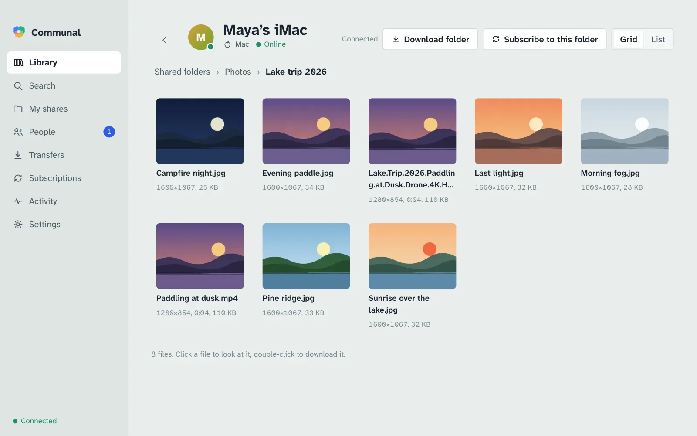

# Communal

Private, Napster-style file sharing for people who know each other. A small server called a **hub** keeps the directory: who's on it, what they share and who may see it. Files go **directly between computers**, encrypted, and never through the hub.



- **Download:** [latest release](https://github.com/Hypnopompia/Communal/releases/latest) for macOS (Apple Silicon and Intel), Windows and Linux. The app updates itself.
- **Documentation:** <https://hypnopompia.github.io/Communal/>, which covers the [app guide](https://hypnopompia.github.io/Communal/guide.html), the [command line](https://hypnopompia.github.io/Communal/cli.html), [AI agents (MCP)](https://hypnopompia.github.io/Communal/agents.html) and [running a hub](https://hypnopompia.github.io/Communal/hub.html).

## What it does

- Share folders, and choose per folder or file who can see them: only you, particular people or groups, or everyone on a hub. Access is set separately on each hub.
- Browse other people's shared folders or search everything at once. Thumbnails and previews come from the owner's computer.
- Download from several people at once, verified chunk by chunk, with resume.
- Follow a folder to get new files automatically.
- Connect through home routers with hole punching (no relay). When that fails, the app says why and what usually fixes it.
- Add more computers to your account, revoke lost ones, and restore everything from a recovery key.
- Let an AI assistant such as Claude use it through MCP (`communal mcp`, or Settings › AI agents in the app).

## Repository

| Path                | What it is                                                                                 |
| ------------------- | ------------------------------------------------------------------------------------------ |
| `apps/desktop`      | Electron app: the core in a utility process, React UI                                      |
| `apps/cli`          | `communal`: headless client, daemon and CLI                                                |
| `apps/hub`          | `communal-hub`: the hub server and its admin commands                                      |
| `packages/core`     | The client engine (indexing, sync, transfers, previews, subscriptions) and its local API   |
| `packages/protocol` | Message schemas for hub and peer protocols                                                 |
| `packages/crypto`   | Keys, certificates, safety codes, recovery keys                                            |
| `packages/mcp`      | The MCP server for AI agents                                                               |
| `site/`             | The GitHub Pages site                                                                      |
| `docs/`             | Design decisions (`adr/`), progress log, open questions; `HANDOFF.md` is the original spec |

## Development

Needs Node 24 and pnpm (via corepack).

```sh
corepack enable
pnpm install
pnpm check                      # format, lint, typecheck, tests (M2_FILES=5000 for a quicker run)
pnpm --filter @communal/hub dev # a local hub with a self-signed certificate
pnpm --filter @communal/desktop... run build
COMMUNAL_BUILD=dev COMMUNAL_DEV_TLS=self-signed pnpm --filter @communal/desktop start
```

`pnpm dev:stack` runs a hub and two headless clients in Docker. See [CLAUDE.md](CLAUDE.md) for the full command list and architecture notes, and `pnpm release` (scripts/release.mjs) for how releases are made.

## License

[MIT](LICENSE)
